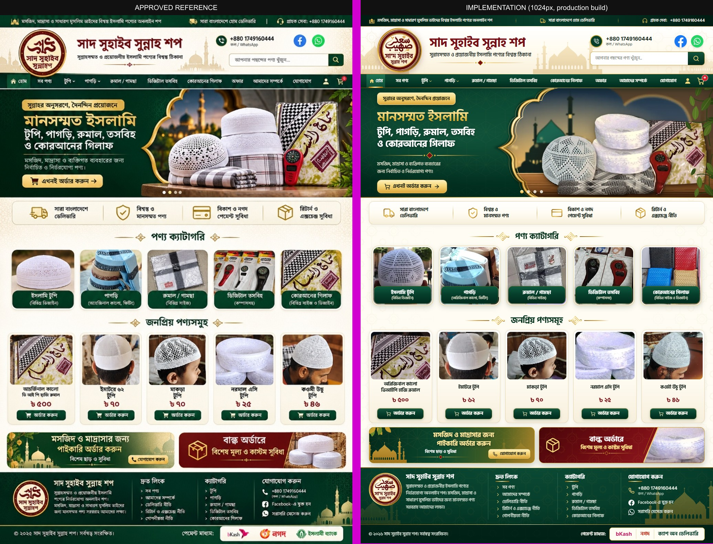

# Storefront Redesign: Delivery Report

**Saad Suhaib Sunnah Shop**, matched against `docs/approved-reference.jpg` (682 × 1024, which is the 1024 × 1536 canvas at ⅔ scale).

## 1. Visual comparison



At 1024 px the homepage is 1536 px tall, the same as the reference canvas.

Screenshots from the production build: [1024](screenshots/home-1024.png) · [1440](screenshots/home-1440.png) · [1920](screenshots/home-1920.png) · [768](screenshots/home-768.png) · [390](screenshots/home-390.png)

### Matched

Section order, header, logo placement, navigation, multifoil gold arch, hero text layout, four slide dots, trust strip, ornamental headings, five category cards, five product cards, both wholesale banners, four-column footer and payment bar.

### Where it differs

| Difference | Reason |
|---|---|
| **The hero is less photorealistic. This is the largest gap.** Product edges, lighting and the folded scarf look flatter, and the mosque is an illustration. | The reference art is a rendered mock-up that was not supplied as a separate asset. The hero is traced from the shop's own phone photos over a hand-drawn backdrop. No image generator was used. |
| Category and popular-product photos show real backgrounds | They are cropped client photos. |
| Quran cover card shows the zipped covers, not the printed packet | The packet in the mock-up is the VIP Haji rumal. |
| ইমাটরে টুপি shows ৳৬২, not ৳৭০ | Prices come from the database. |
| 4th trust item reads "রিটার্ন ও এক্সচেঞ্জ **নীতি**" and links to the policy | The stored return policy is still marked as awaiting client confirmation. |
| Payment bar uses text wordmarks and shows cash on delivery instead of Islami Bank | No official logo files were supplied. Bank transfer is switched off in Settings. |
| Logo differs in detail | The original logo file is used. |
| Product names mostly fit on one line, and some icons are smaller | Real names and fonts. |

## 2. What changed

**Design**
- Gold, emerald, maroon and ivory design tokens, with self-hosted Hind Siliguri and Noto Sans Bengali.
- SVG ornaments in `public/patterns` and `public/decorations`.
- Same design language on the public pages. The product page has image zoom, gold thumbnails and a gold buy-now button.
- Search suggestions, product dropdowns, quick view, hero swipe and keyboard control, cart drawer, mobile menu and bottom bar. Reduced-motion settings are respected.
- Admin: its own layout without the shop header and footer, gold active menu item and a mobile menu.

**Content and CMS**
- Admin → CMS now edits all hero slides (add, edit, order, switch off), both wholesale banners, trust-strip titles and category subtitles. Images are set by path or URL.
- New product edit page. Before this, an existing product's price could not be changed in the admin.
- Three extra hero slides were added. **Please review their wording.**
- The homepage "special cap collection" section was removed because it is not in the reference. The caps remain under the টুপি category.
- Unconfirmed claims were removed from the components and pages that were rebuilt or edited ("১০০% সুন্নাহসম্মত" hero tag, "১০০% খাঁটি পণ্য", delivery guarantee, factory-direct lowest price). The About and Wholesale pages still contain marketing wording that the owner should confirm.
- The product page no longer shows `salePrice` crossed out. Checkout charges the regular price.

## 3. Security and bug fixes

| Problem found | Fix |
|---|---|
| **Admin pages opened without login** and showed customer names, phones and orders. Two save actions also had no login check. | Middleware, a server-side check on every admin page, and checks inside inline actions |
| **Login page showed and pre-filled the admin password** | Removed |
| **Order tracking accepted a one-digit phone number** and returned the customer's name, phone and address | A full 11-digit number is now required |
| Checkout showed fixed delivery rates and payment numbers while charging the rates in Settings | Reads Settings. Disabled payment methods are hidden |
| Checkout had no coupon field | Added |
| Adding the same item again could create a duplicate, unremovable cart line | Fixed |
| Category pages could add a cap to the cart without a size | Sizes are now loaded |
| Bengali search failed for one of the two encodings of ড় / ঢ় / য় | Both are searched |
| One optimised AVIF image request hung | Images are served as WebP. The root cause was not established |

## 4. Test results

| Check | Result |
|---|---|
| Unit tests | 41 of 41 pass |
| TypeScript check and production build | Pass |
| Browser end-to-end run in Chrome, production build | 38 of 38 pass |
| Pages at 320, 390, 768, 1024, 1440, 1920 px | 16 URLs each: no horizontal overflow or broken images |
| Browser console errors | None |
| Homepage load, local server, cold cache | Desktop: LCP 0.8 s, CLS 0.002, 1.2 MB. Mobile: LCP 0.6 s, CLS 0.008, 1.0 MB |

The end-to-end run covered homepage links, WhatsApp/Facebook/phone link addresses, search, filtering, sizes, cart, order placement and stock, tracking, wholesale form, admin login and pages, price edit, CMS edits and the delivery rate. The database was restored afterwards.

After that run, three fixes were made (duplicate category heading, sizes on category pages, tracking phone check). Each was checked separately, and unit tests and the build were rerun. The full end-to-end run was not repeated.

**Not tested:** Safari, Firefox, physical phones, a formal accessibility audit, Lighthouse, real network speeds, touch swipe, an order paid by bKash or Nagad, and a coupon order. Product image upload does not exist in this project.

## 5. Not built

- Customer registration, login and account pages: the site has guest checkout only. The account icon opens order tracking.
- Wishlist and image file upload.

## 6. Still open

1. **If this site has ever been online:** change the admin password and set a new random `AUTH_SECRET`. The code falls back to a fixed secret if the variable is missing, which would let someone forge an admin login.
2. The order success page shows name, phone and address to anyone who has its link. Order numbers are short enough to be a guessing risk.
3. Login and order tracking have no rate limiting.
4. The public search API returns wholesale prices.
5. `public/hero-reference.jpg` (the mock-up) is no longer used but is still publicly reachable. `IslamicCapCollection.tsx` is also unused.

## 7. Assets needed to close the visual gap

- A high-resolution hero image: a styled studio photo of the real products, about 1600 × 840, ideally with a transparent background
- Clean product photos without price bubbles or camera watermarks
- A plain white cap and a turban photo for the category cards
- Official bKash, Nagad and bank logo files
- Confirmation of the return and exchange policy

A new hero image can be set in Admin → CMS. A path starting with `/hero/` is shown as a cut-out inside the arch; any other path is shown as a framed photo.

## 8. Running and deploying

```powershell
pnpm install
pnpm build
pnpm start
```

For another database (for example production), run the content update once after deploying. It deletes nothing, replaces only original seeded values, and needs no schema change:

```powershell
node --env-file=.env scripts/apply-redesign-data.cjs
```

Artwork can be rebuilt from the originals with `node scripts/build-assets.cjs` and `node scripts/build-ornaments.cjs`.

A copy of the source and database from before the redesign is in `E:\EHSARA\site-backup-before-redesign`.
